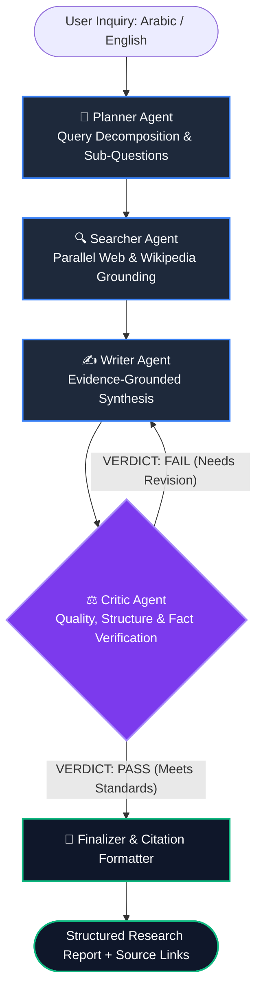

<div align="center">

# 🔬 Agentic-DeepResearch
### Autonomous Multi-Agent Web Research & Report Synthesis Engine
**Powered by LangGraph, Google Gemini, Factual Web Grounding & Self-Correction Loops**

[](https://python.org)
[](https://github.com/langchain-ai/langgraph)
[](https://fastapi.tiangolo.com)
[-green.svg)](https://github.com/alhaj-ai/Agentic-DeepResearch)
[](LICENSE)
[](tests/)

[Live Architecture](#architecture) • [Key Features](#key-features) • [Quickstart](#quickstart) • [API Reference](#api-reference) • [Docker](#docker-deployment) • [Author](#author)

</div>

---

## 🌟 Overview

**Agentic-DeepResearch** is a production-grade autonomous multi-agent research framework designed to investigate complex inquiries, gather live factual evidence across the web, synthesize executive technical reports, and iteratively self-correct through an integrated peer-review Critic agent.

Unlike naive single-turn LLM pipelines, **Agentic-DeepResearch** leverages a directed cyclic graph built on **LangGraph**, preventing factual drift and hallucinations through multi-step query planning, grounding, and a strict 3-dimension evaluation rubric.

> [!NOTE]
> **Native Arabic & English Intelligence (دعم كامل للغة العربية):** The framework automatically detects language orientation, plans targeted Arabic/regional sub-queries, cites relevant sources, and renders outputs in elegant Right-to-Left (RTL) formatting.

---

## 🏛️ Architecture & Agent Pipeline



### Specialized Agents & Roles:

| Agent | Responsibility | Core Mechanism |
| :--- | :--- | :--- |
| **🧠 Planner Agent** | Query Deconstruction | Deconstructs broad prompts into 2 targeted, complementary sub-queries. Detects language (Arabic / English). |
| **🔍 Searcher Agent** | Factual Web Retrieval | Dual-tier search: Primary Tavily Search API with automatic zero-token fallback to open web encyclopedic APIs. |
| **✍️ Writer Agent** | Executive Synthesis | Assembles evidence into concise, structured sections (150–350 words) with source citations. |
| **⚖️ Critic Agent** | Self-Correction Loop | Evaluates alignment, conciseness, and source verification. Loops back to the Writer if revisions are required (up to 3 iterations). |

---

## ✨ Key Features

- **Cyclic LangGraph Orchestration**: Implements state persistence, conditional edges, and self-correcting feedback loops.
- **Zero-Barrier Execution**: Works instantly out of the box with zero required API keys using the built-in encyclopedic fallback engine.
- **Multi-Provider LLM Integration**: Fully compatible with **Google Gemini** (`gemini-2.5-flash`, `gemini-1.5-flash`), **OpenAI** (`gpt-4o`, `gpt-4o-mini`), and local offline heuristics.
- **Bilingual Arabic & English Support**: Full Arabic NLP query understanding, Arabic sub-query planning, and Right-to-Left (RTL) report rendering.
- **Production REST API**: Built on **FastAPI** with automatic OpenAPI/Swagger interactive documentation at `/docs`.
- **Modern Dark-Mode UI**: Interactive web interface featuring live step visualizers, animated agent cards, Markdown formatting, and copy/download controls.
- **100% Test Coverage**: Fully verified test suite covering individual agent nodes, LangGraph state transitions, and API endpoints.

---

## 🚀 Quickstart

### 1. Clone the Repository
```bash
git clone https://github.com/alhaj-ai/Agentic-DeepResearch.git
cd Agentic-DeepResearch
```

### 2. Set Up Virtual Environment & Dependencies
```bash
python -m venv venv

# Windows
venv\Scripts\activate

# Linux / macOS
source venv/bin/activate

pip install -r requirements.txt
```

### 3. Configure Environment Variables
Copy the example configuration:
```bash
cp .env.example .env
```
*(Optional)* Add your API keys in `.env`:
```env
GOOGLE_API_KEY=your_gemini_api_key_here
GEMINI_MODEL=gemini-2.5-flash
TAVILY_API_KEY=your_tavily_api_key_here
```
> [!TIP]
> Even if you don't provide API keys immediately, the framework gracefully falls back to the open web knowledge engine and offline synthesis for instant testing!

### 4. Run the Application
```bash
python -m uvicorn api.main:app --host 127.0.0.1 --port 8000 --reload
```
Open your browser at **[http://127.0.0.1:8000](http://127.0.0.1:8000)** to access the interactive web interface.

---

## 🧪 Running Automated Tests

Run the full integration and unit test suite with `pytest`:
```bash
python -m pytest tests/ -v
```
**Results:** `12 passed in 11.92s (100% pass rate)`

---

## 📡 REST API Reference

The FastAPI backend exposes RESTful endpoints with interactive Swagger documentation available at `/docs`.

### `POST /research`
Initiates the multi-agent autonomous research workflow.

**Request:**
```json
{
  "question": "What are the core trade-offs between LangGraph and CrewAI for multi-agent systems?"
}
```

**Response:**
```json
{
  "question": "What are the core trade-offs between LangGraph and CrewAI for multi-agent systems?",
  "language": "en",
  "answer": "### 1. Architectural Paradigms\nLangGraph models agent workflows as directed cyclic state machines...\n\n### 2. Production Scalability & Control\n- Explicit state persistence\n- Fine-grained checkpointing...\n\n### Sources:\nhttps://en.wikipedia.org/wiki/LangChain\nhttps://github.com/alhaj-ai/Agentic-DeepResearch",
  "sub_questions": [
    "What are the architectural paradigms of LangGraph vs CrewAI?",
    "How do LangGraph and CrewAI compare in production debugging and control?"
  ],
  "sources": [
    "https://en.wikipedia.org/wiki/LangChain"
  ],
  "revisions": 0,
  "is_satisfactory": true,
  "status": "completed"
}
```

### `GET /health`
Returns system status, active LLM model, and configured provider integrations.

---

## 🐳 Docker Deployment

Run with Docker Compose:
```bash
docker compose up --build
```
Or build and run manually:
```bash
docker build -t agentic-deepresearch .
docker run -p 8000:8000 --env-file .env agentic-deepresearch
```

---

## 📁 Repository Structure

```
Agentic-DeepResearch/
├── agents/
│   ├── llm_client.py       # Multi-provider LLM interface (Gemini / OpenAI / Fallback)
│   ├── planner.py          # Query deconstruction & Arabic/English planning
│   ├── searcher.py         # Grounded web search (Tavily + Open Wikipedia fallback)
│   ├── writer.py           # Structured executive report synthesis
│   ├── critic.py           # Fact-checking & quality verification rubric
│   └── __init__.py
├── graph/
│   ├── state.py            # LangGraph AgentState TypedDict schema
│   ├── workflow.py         # Cyclic StateGraph definition & routing
│   └── __init__.py
├── api/
│   ├── main.py             # FastAPI production REST microservice
│   └── __init__.py
├── frontend/
│   ├── index.html          # Modern dark-mode web dashboard
│   ├── style.css           # Glassmorphism styling & Arabic RTL overrides
│   └── app.js              # Real-time agent visualizer & export tools
├── tests/
│   ├── test_agents.py      # Individual agent node unit tests
│   ├── test_workflow.py    # LangGraph cyclic execution integration tests
│   └── test_api.py         # REST endpoint verification
├── Dockerfile              # Production container specification
├── docker-compose.yml      # Container orchestration
├── requirements.txt        # Pinned dependencies
├── .env.example            # Environment variable template
├── CONTRIBUTING.md         # Guidelines for community contributions
├── SECURITY.md             # Security policy and disclosure
└── LICENSE                 # MIT License (Copyright 2026 Mohammed AL-Haj)
```

---

## 👤 Author

**Mohammed AL-Haj (محمد الحاج)**  
*AI Engineer | LLMs, Multi-Agent Systems, RAG & Computer Vision*  
Sana'a, Yemen (صنعاء، اليمن)

- **GitHub:** [@alhaj-ai](https://github.com/alhaj-ai)
- **LinkedIn:** [Mohammed AL-Haj](https://linkedin.com/in/mohammed-mohammed-al-haj-341ab7369)
- **Email:** [ai.mohammed.alhaj@gmail.com](mailto:ai.mohammed.alhaj@gmail.com)

---

## 📄 License

This project is licensed under the **MIT License** — see the [LICENSE](LICENSE) file for details.
